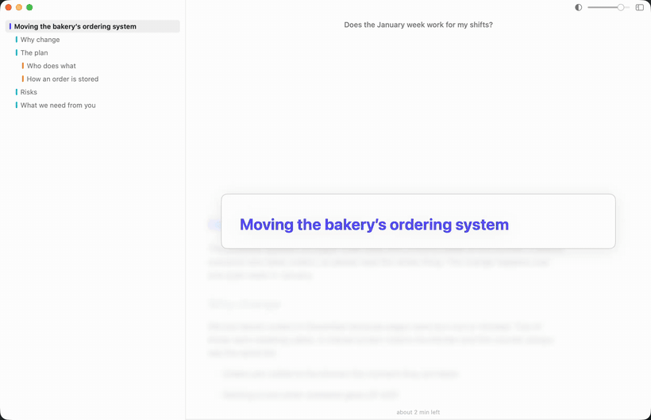
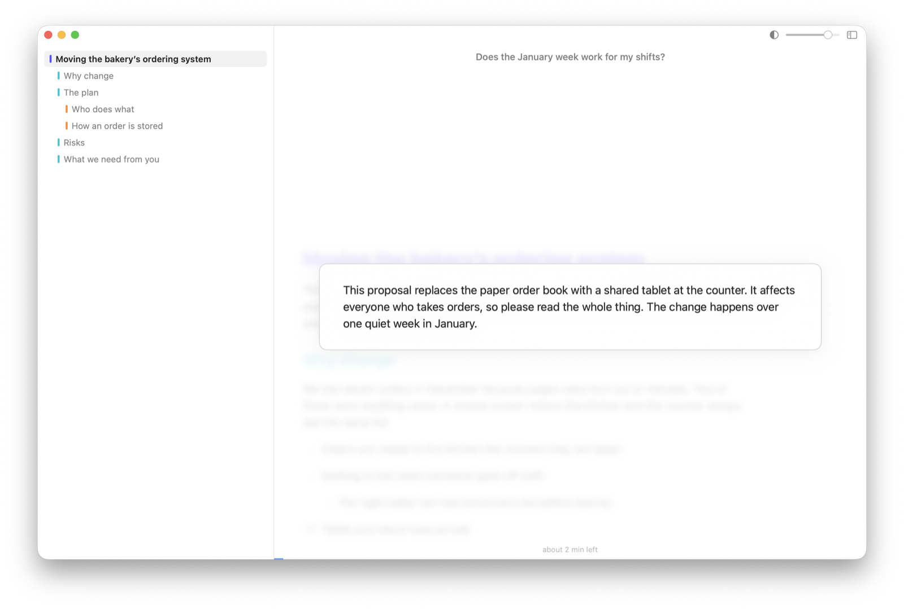
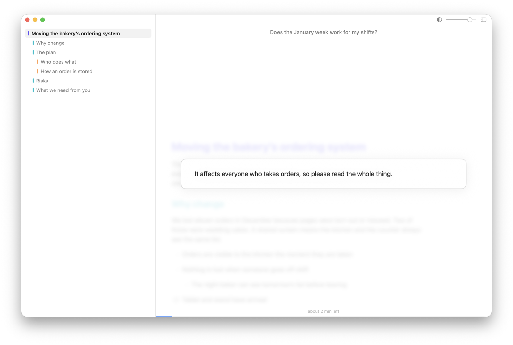
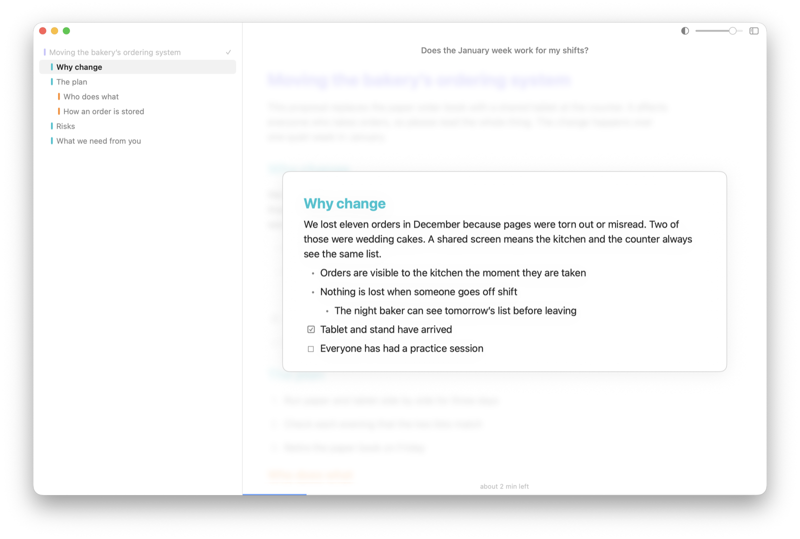
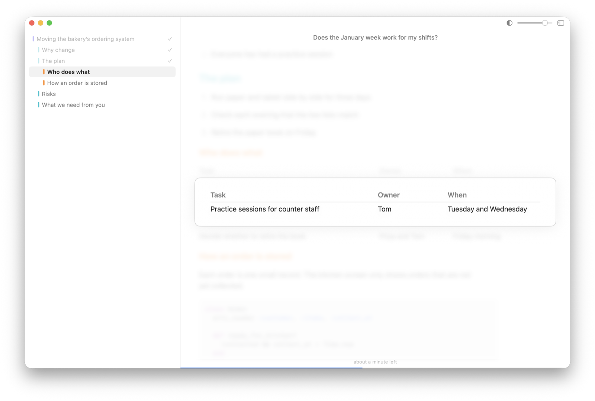
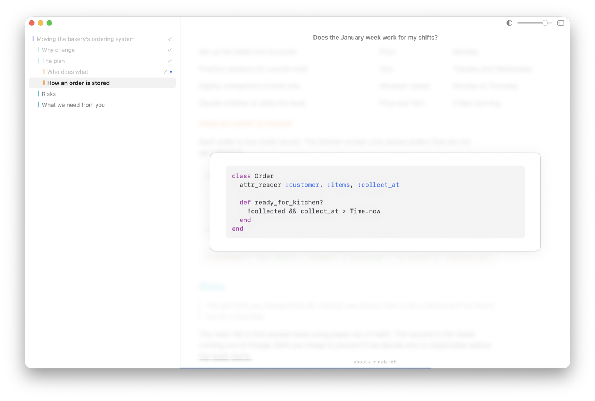
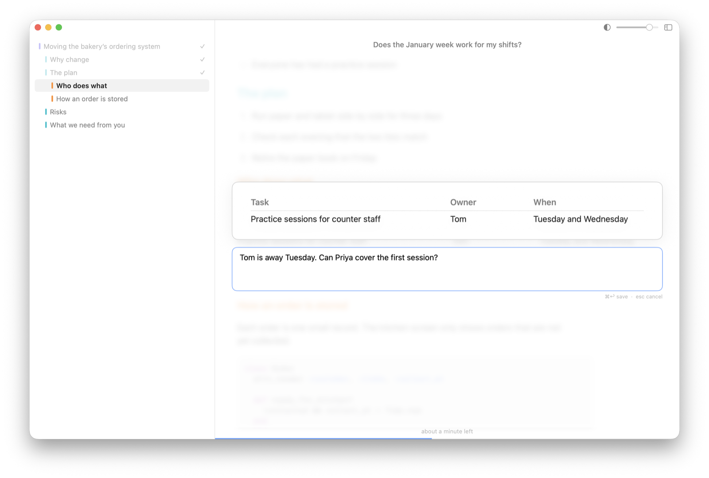
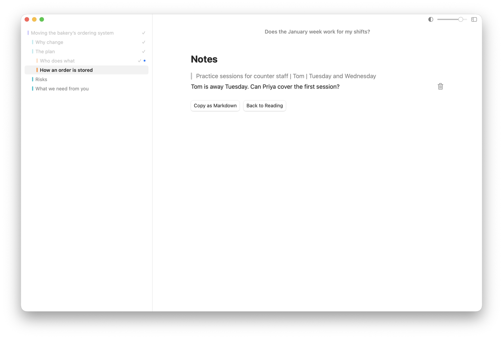
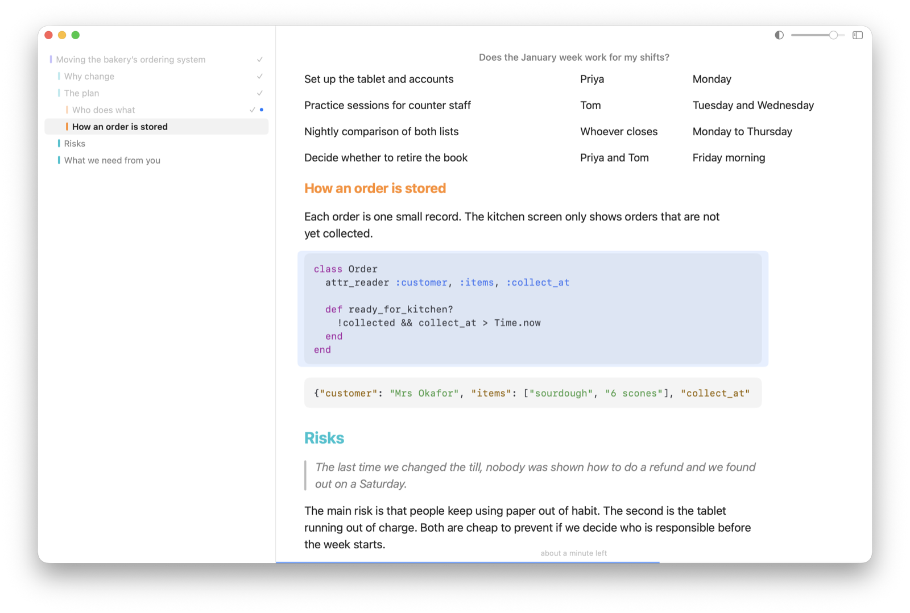

# Spaced

A macOS reader that shows a markdown document one piece at a time. It's for getting through long documents and agent output when a wall of text is hard to stay with: you see one sentence, paragraph or section, press Space, and see the next.



The same walkthrough as a sharper video: [docs/walkthrough.mp4](docs/walkthrough.mp4). The document in it is [docs/demo.md](docs/demo.md).

## What it does

**One piece at a time.** The current paragraph, list item or table row sits in a bordered box over a dimmed, blurred copy of the document, so you can see the shape of what's around it without being able to read it. The question you're trying to answer stays pinned at the top.



**Narrow to a sentence, widen to a section.** Down arrow shows a single sentence; up arrow shows everything under the current heading.

| One sentence | A whole section |
| --- | --- |
|  |  |

**Tables and code.** Tables are read a row at a time with their column names, and use the full width of the window. Code is syntax highlighted.

| A table row | A code block |
| --- | --- |
|  |  |

**Notes you can hand back.** Press Return on anything to respond to it. The review screen collects your notes as a blockquote of the text followed by your response, ready to copy as markdown.

| Writing a note | Reviewing notes |
| --- | --- |
|  |  |

**The whole document when you want it.** Esc drops the box and shows everything, with your place marked.



Also:

- A sidebar of headings, coloured by level, with sections ticked off as you pass them.
- A progress bar and a time-left estimate.
- Reading aloud with the system voice, marking each word as it's spoken.
- A parking lot: jot down an unrelated thought without leaving your place.
- Tabs that survive quitting, crashing and restarting. There's nothing to save.
- Light and dark mode, following the system.

## Install

There's no prebuilt download yet. Building from source needs macOS 15 or later on Apple silicon and the Xcode Command Line Tools (`xcode-select --install`); Xcode itself isn't required.

```sh
git clone https://github.com/ideasasylum/spaced.git
cd spaced
make install   # copies Spaced.app to /Applications and links `spaced` into ~/.local/bin
```

Set `PREFIX` to put the command somewhere else, for example `make install PREFIX=/opt/homebrew`.

Other targets:

```sh
make test      # core tests (use this rather than a bare `swift test`)
make app       # builds build/Spaced.app
make run       # builds and opens it
```

## Opening documents

Paste markdown with ⌘V, drop a file on the window, use ⌘O, or use the command line:

```sh
spaced plan.md
cat output.md | spaced --ask "Is the migration safe?"
spaced --wait plan.md
```

`--ask` pins a question above the document. `--wait` blocks until you press "Send Notes & Close" and then prints your notes, which lets a coding agent hand you something to review and get your comments back:

```markdown
> Nightly comparison of both lists | Whoever closes | Monday to Thursday

Add this to the closing checklist.
```

## Keys

| Key | Action |
| --- | --- |
| Space / → | next |
| Shift+Space / ← | previous |
| ↑ / ↓ | widen / narrow focus: sentence, block, section |
| Esc | toggle whole document |
| Return | note on the current piece (⌘Return saves, Esc cancels) |
| ⌘[ / ⌘] | previous / next section |
| ⌥↑ / ⌥↓ | more / less dimming |
| S | read aloud / stop (keeps going to the end unless turned off in the Read menu) |
| P | park an unrelated thought for later (shown on the review screen) |
| ⇧⌘R | review notes |
| ⇧⌘C | copy notes as markdown |
| ⌃⌘S | toggle sidebar |
| ⌥⌘B | blur the background |
| ⌥⌘E | bold the start of each word in the box |
| ⌘+ / ⌘− / ⌘0 | text size |
| ⌘N / ⌘T / ⌘W | new window / new tab / close |

Everything is in the menus too, so shortcuts can be changed in System Settings.

Reading aloud uses the system voice. `defaults write dev.spaced.Spaced speechVolume 0.5` turns it down without touching system volume.

## How it's built

- `Sources/SpacedCore`: parsing, navigation, sessions, export. No UI.
- `Sources/SpacedUI`: AppKit shell and SwiftUI views.
- `Sources/SpacedApp`, `Sources/SpacedCLI`: the two executables.

Markdown parsing is [swift-markdown](https://github.com/swiftlang/swift-markdown); syntax highlighting is [Highlightr](https://github.com/raspu/Highlightr), which wraps highlight.js.

The Command Line Tools don't ship SwiftUI's macro plugin, so `@State` can't be used in views until the project moves to Xcode; view state lives in `SessionModel` instead.

## Not done yet

- A signed, notarised download and a Homebrew cask.
- An Xcode project wrapping the same package.

## Licence

MIT. See [LICENSE](LICENSE).
